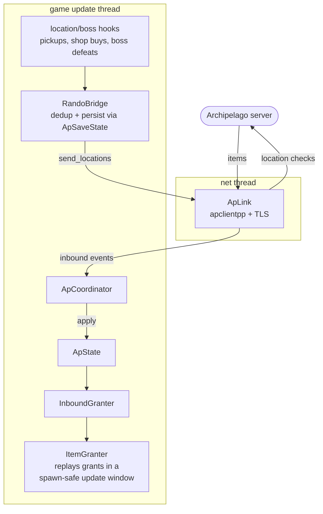

# Architecture

mth-apclient is an in-process mod for **Mina the Hollower** that acts as an
[Archipelago](https://archipelago.gg/) randomizer client. It loads into the running game, hooks a
handful of game functions, and bridges the game's item/location system to an Archipelago server.

The game runs on a custom engine (`yc`), rendering with Vulkan on Linux and Direct3D 12 on Windows.

## Targets

The build has a strict dependency direction (`core` <- `pal` <- `mthap`). Two targets hold our code. The PAL, the net link, the feature hooks, the UI and the ImGui overlay sources are compiled straight into the module, and Dear ImGui itself is an object library (`mthap_imgui`) linked into it:

| Target       | Kind       | Contents                                                                                                                                                                                                                       |
| ------------ | ---------- | ------------------------------------------------------------------------------------------------------------------------------------------------------------------------------------------------------------------------------ |
| `mthap_core` | static lib | Pure, cross-platform logic under `src/mth/core/`, plus the wrapper over the game's mod API (`src/mod/`, with the live `MinaModAPI*` injected so tests can substitute a fake). It holds AP state and coordinator, the location/item bridge, inbound granter, save container and state, ID mapping, enforcement rules, the dev command parser and the signature matcher. No OS/backend headers that require linking. |
| `mthap`      | module     | The final shared object (`mod.so` / `mod.dll`). The composition root (`mth::App`) wires it all together. It also holds the per-feature hooks (`src/mth/features/`), the AP link (`src/mth/net/`), the UI (`src/mth/ui/`) and the PAL (`src/pal/`). |

`mth::App` owns the runtime. The logger is a PAL global behind `pal::ILog`, which tests swap with
`pal::set_default_log`, so the core can be unit-tested without a real platform. The hook engine
(`pal::install_hook` / `pal::remove_hook`) and the overlay (`pal::overlay_start`)
are plain functions implemented once per platform.

The unit tests (`mthap_unit_tests`) link `mthap_core`, and additionally compile in the Linux
file-log and certificate-store PAL sources plus `features/death_hooks.cpp` and `net/deathlink.cpp`
to exercise them directly. That makes the test lane Linux-only: it does not build on Windows. The
`clang-x64-tests` preset inherits `clang-x64-debug`, so a test build also builds the module.

## Loading

|              | Linux                                     | Windows                                                 |
| ------------ | ----------------------------------------- | ------------------------------------------------------- |
| Binary       | `mod.so`                                  | `mod.dll`                                               |
| Manifest     | `mod.yc`                                  | `mod.yc`                                                |
| Mechanism    | Native game mod loader (modding beta)     | Native game mod loader (modding beta)                  |
| Entry point  | `MinaMod_Init(MinaModAPI*)`               | `MinaMod_Init(MinaModAPI*)`                             |
| Hook backend | Frida-Gum                                 | MinHook                                                 |

Both files (`mod.so`/`mod.dll` and `mod.yc`) belong in a per-mod folder under the game's mods
directory, which lives in its save dir (the SDL pref path). On Linux that is
`~/.local/share/Yacht Club Games/Mina the Hollower/mods/apclient/`. On Windows it is
`%APPDATA%\Yacht Club Games\Mina the Hollower\mods\apclient\`. Both `-mod` and `-mod-allow-code`
are needed on the modding beta branch: `-mod` turns the loader on, `-mod-allow-code` lets it load
a mod's compiled library. Each is matched as a whole argument, case-insensitively, with a leading
`-` or `--` stripped. Without `-mod` the loader returns before doing anything, so no `mod.log` is
written at all; with it, the loader writes `mod.log` in that save dir every run.

## Resolving game functions

Hooks target specific game functions, resolved differently per platform behind a single PAL seam
(`pal::resolve_game_symbol`):

- **Linux**: As of Mina v1.0.6, the game binary is not stripped (it ships DWARF), so functions are
  resolved by their mangled symbol name via Frida's symbol table.
- **Windows**: the shipping PE is stripped, so there is no name to resolve. Addresses come from
  the mod API's `GetSymAddr` where the game exposes the name, then from a hook-name-hash anchor,
  and only then from scanning the `.text` section for masked byte signatures. The pure matcher
  lives in `core` and is unit-tested. The signature table is `src/pal/windows/win_signatures.cpp`,
  edited by hand and validated against the shipping build with `scripts/validate_signatures.py`.

The hook mechanisms and the signature-table workflow are documented in
[reverse-engineering.md](reverse-engineering.md).

## The Archipelago data flow



- **Outbound**: pickup hooks detect when a randomized location is collected, map it to an
  Archipelago location id, deduplicate against persisted state, and send it.
- **Inbound**: items received from the server are applied on the game thread by replaying the
  game's own item-grant path, in a window where spawning is safe.
- **Persistence**: checked locations and granted items are persisted per `(seed, slot)` so
  reconnects and reloads don't double-send or double-grant.
- The network stack (apclientpp / wswrap / websocketpp with OpenSSL) lives in `src/mth/net/` and
  implements the `IApLink` interface from core. The tests use an in-memory fake of it, and the real link is also tested over a loopback websocket (`tests/unit/ap_link_net_test.cpp`, `tests/mocks/scripted_ap_server.hpp`).

## In-game overlay

A Dear ImGui dev console (toggle **F1**) renders over the game and offers commands to
connect, inspect status, and list items. It is implemented per platform but shares one
platform-agnostic console:

- **Linux**: hooks `vkQueuePresentKHR` for rendering and the SDL event path for input.
- **Windows**: hooks the DXGI swap-chain `Present` and the D3D12 command queue, with input via a
  window-procedure subclass.

## Linux runtime constraint

The mod is injected into the game's runtime, which may use an older glibc than the build host. If
the binary required glibc symbol versions newer than the runtime provides, the dynamic loader would
reject it before any of our code runs: no log, no game window. A post-build check
(`scripts/check-glibc-max.sh`) fails the build if any required glibc symbol exceeds the supported
floor. A small compatibility shim (`src/pal/linux/glibc_compat_linux.cpp`) pins or provides the
few symbols that would otherwise raise it.

## Repository layout

```
src/mth/core/ap/       AP link interface, state, coordinator, slot_data, ID tables, location/item bridge, inbound granter
src/mth/core/save/     mod-owned save container: bundle, store, zip, AP save state, takeover state machine
src/mth/core/game/     game data tables: layout offsets, symbols, component and gamestate ids, signature matcher,
                       modifiers, shop/title constants, pure game_tables predicates
src/mth/core/rules/    enforcement policy: gates, burrow boundary, progression (level caps, upgrades, wallet),
                       goal and kear completion, traps, lock registry
src/mth/core/console/  dev command parser, log ring, login prefs
src/mth/app/           composition root: App, HookManager, startup gate probes
src/mth/features/      per-feature game hooks (pickups, bosses, locks, player tracking, item grants, save takeover);
                       game_table_access.* reads and patches s_rItems / s_rItemCollection
src/mth/features/scene_gates/  intro chest, sewer cat and ticket machine gates plus the shared scene_walk
src/mth/features/menus/        pawn shop, shop menu, title gate and status menu caps
src/mth/net/           Archipelago link implementation and deathlink payloads
src/mth/ui/            dev console, login window, banners
src/mod/               wrapper over the game's native mod API
src/pal/               platform-neutral PAL: pal_*.hpp interfaces, pal_layout.hpp offsets, ScopedHook, log, mod entry
src/pal/linux/         Linux PAL (Frida, Vulkan/SDL overlay, game detours, symbol lookup)
src/pal/windows/       Windows PAL (MinHook, D3D12 overlay, game detours, symbol lookup and win_signatures.cpp)
cmake/                 dependency, toolchain and compiler modules
scripts/               glibc check and signature tooling
tests/unit/            Catch2 unit tests (globbed); tests/mocks/ holds the fakes
external/vcpkg/        vcpkg submodule
```
